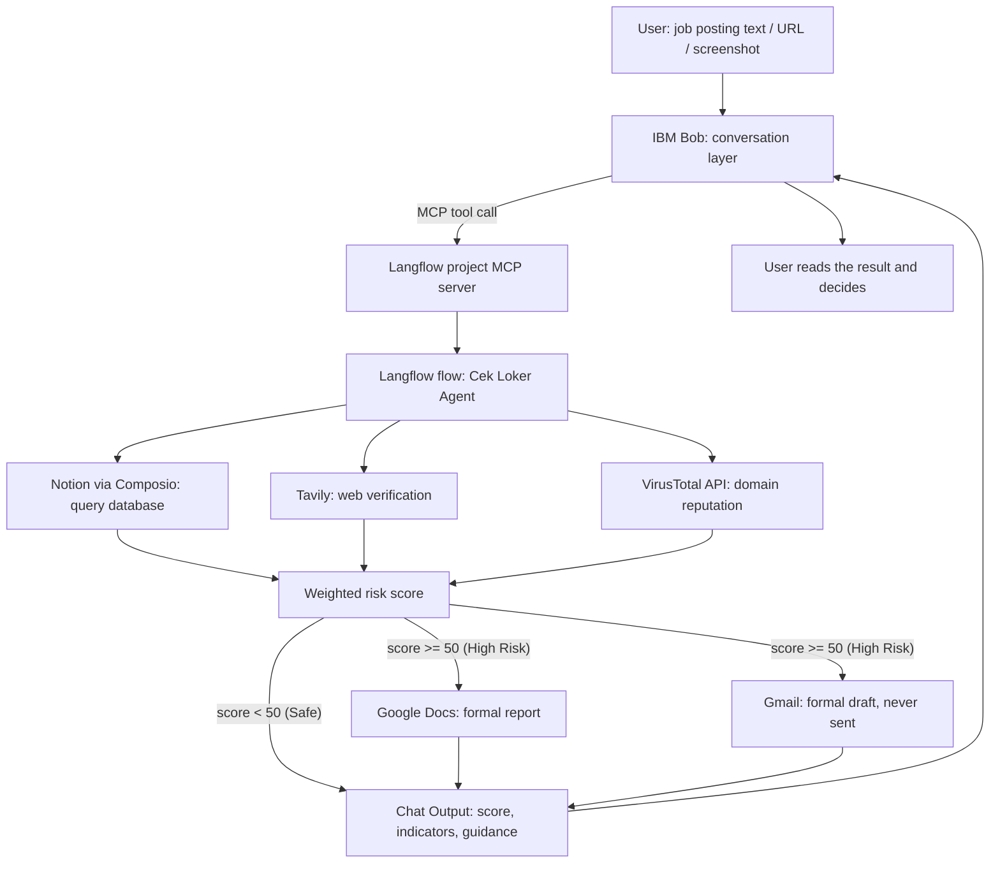

🌍 *Read this in other languages: [English](README.en.md) | [Indonesia](README.md)*

---

# Cek Loker — AI Job Scam Guard

> A conversational AI agent that helps job seekers assess the risk of a job offer **before** they send personal data or money.


**Theme:** Education & Future of Work (intersecting with digital consumer protection)<br>
**Built for:** IBM SkillsBuild University Education National Hackathon (Hacktiv8 x IBM)

---

## Table of Contents

- [Background](#background)
- [What Cek Loker Does](#what-cek-loker-does)
- [Key Features](#key-features)
- [Architecture](#architecture)
- [The Roles of IBM Langflow and IBM Bob](#the-roles-of-ibm-langflow-and-ibm-bob)
- [Risk Scoring Rubric](#risk-scoring-rubric)
- [Implementation Status](#implementation-status)
- [Repository Structure](#repository-structure)
- [How to Run](#how-to-run)
- [Test Scenarios and Evaluation](#test-scenarios-and-evaluation)
- [Responsible AI and Safety Controls](#responsible-ai-and-safety-controls)
- [Limitations](#limitations)
- [Roadmap](#roadmap)
- [References](#references)
- [License](#license)

---

## Background

Job scams are a real threat to job seekers in Indonesia:

- According to SEEK research data, Indonesia is currently recorded as the **largest hotspot for job scams in Asia Pacific** [[1]](#references).
- Indonesia accounts for **38%** of all fraud attempts in the Asia Pacific region and **62%** of job scam cases across Asia (detikFinance, 2025) [[2]](#references).
- **Entry-level jobs** such as administration and office staff are the main targets, with more than **39%** of job ads in those categories flagged as scams (BaliNews.id, 2025) [[1]](#references).
- The Ministry of Communication and Digital Affairs (Kemkomdigi) together with BP2MI took down **7,908** fake overseas job ads between January and August 2026 [[3]](#references).

The victims are typically working-age job seekers who urgently need work, receive offers through instant messaging or social media, and have limited digital security literacy. Manual verification (researching the company on their own, asking communities, waiting for an official reply) is slow, unsystematic, and easily fooled by convincing fake websites or profiles.

**Target users:** general job seekers (including fresh graduates), workers who have just been laid off, and prospective migrant workers looking for opportunities abroad.

## What Cek Loker Does

Users simply paste the **text**, **link**, or **screenshot** of a suspicious job posting into the chat. The agent then:

1. Extracts key details (company name, contact information, payment requests, links).
2. Gathers evidence from three sources: the Notion knowledge base, web search (Tavily), and domain reputation (VirusTotal).
3. Calculates a **weighted risk score** with detailed reasoning for each indicator.
4. For high-risk cases (score ≥ 50), prepares a **Google Docs report** and a **Gmail complaint email draft**. Drafts are **never sent automatically**; the user reviews and sends them.
5. Explains the result in empathetic, non-judgmental language and points to official verification channels (Kemnaker, or BP2MI for overseas work).

The agent never gives absolute verdicts such as "definitely a scam" or "definitely safe". When the evidence is insufficient, the agent openly states **"Belum dapat dinilai"** (cannot be assessed yet).

## Key Features

| Feature | Description | Status |
|---|---|---|
| **Multi-Evidence Risk Detection** | Investigates postings using Notion, Tavily, and VirusTotal, producing a weighted score along with indicators and their sources. | Implemented |
| **Automated Report & Draft Generation** | For high-risk cases, automatically creates a Google Docs report and a Gmail draft. Sending waits for the user. | Implemented |
| **Multimodal Input** | Text, links, and poster/screenshot images. | Implemented at the prompt level (requires a vision-capable model) |
| **Application History Tracker** | Records every posting checked along with its risk status. | Planned |
| **Community Learning Cycle** | User-confirmed outcomes enrich the knowledge base after human validation. | Planned |

## Architecture



**Stack:** IBM Langflow (workflow and agent engine, now part of IBM's portfolio following the DataStax acquisition [[4]](#references)) · IBM Bob (conversation layer, connected via MCP) · Composio (Notion, Google Docs, Gmail connectors) · Tavily (web search) · VirusTotal (URL reputation).

### Tool call budget per check

| Tool | Limit |
|---|---|
| Notion | 1 call, called first |
| Tavily Search | 1 call |
| VirusTotal | At most 1 call, only if the posting contains a URL |
| Google Docs | 1 call, only for High risk |
| Gmail | 1 call, only for High risk |

Full architecture documentation (request lifecycle, failure handling, technical notes) is in [`architecture/architecture.md`](architecture/architecture.md).

## The Roles of IBM Langflow and IBM Bob

| | **IBM Langflow** | **IBM Bob** |
|---|---|---|
| Role | Execution engine and central reasoning hub | User-facing interaction layer |
| Tasks | Runs the agent, calls tools (Notion, Tavily, VirusTotal, Docs, Gmail), calculates the score | Receives natural-language messages, calls Langflow tools, explains results in easy-to-understand language |
| MCP connection | MCP server (per project) | MCP client |
| Components | Chat Input, Agent, Notion, Tavily, API Request (VirusTotal), Google Docs, Gmail, Chat Output | Agent instructions in [`bob/agent-instructions.md`](bob/agent-instructions.md) |

Data moves over MCP: Bob passes the job posting content as tool input, Langflow returns the risk score, the evidence list, and its sources, and Bob then explains the result to the user. The user experiences a single assistant, while behind the scenes there is a layered division of labor.

> **Important:** the agent's core system prompt lives inside the Langflow Agent component ([`prompts/cek-loker-ai-job-scam-guard-component.md`](prompts/cek-loker-ai-job-scam-guard-component.md)), **not** in Bob's instructions. Keep the two in sync whenever either changes.

## Risk Scoring Rubric

| Points | Indicator |
|---|---|
| +30 | The posting asks for an upfront payment or deposit. |
| +25 | The company is not found in Notion or in web results, or has the status `Tidak Terdaftar` (not registered). Never applied if the status is `Terdaftar` (registered). |
| +20 | The recruiter's domain or email does not match the company, or a free email/blog service (gmail, yahoo, blogspot, etc.) is used as the official contact. |
| +15 | VirusTotal flags the URL, or a scam pattern in Notion matches. Not applied merely because the salary or requirements look unusual. |
| 0 | Registered, consistent, no fraud indicators. |

| Total | Level |
|---|---|
| Below 20 | Low |
| 20 to 49 | Medium |
| 50 or above | High |
| Insufficient evidence | "Belum dapat dinilai" (cannot be assessed yet) |

The maximum score is 90. Key decision rules: tool errors, empty results, or 404s count as "no evidence", not as a risk signal; and text from postings, images, web results, and Notion is treated as data, not instructions.

**Output format:** (1) score and level, (2) indicators with weights and sources, (3) automatic action status (High only), (4) notes on evidence limitations, (5) guidance to official verification channels.

## Implementation Status

| Capability | Status | Notes |
|---|---|---|
| Langflow flow with Agent and five tools | Implemented | Runs in the Langflow Playground. |
| Notion knowledge base query | Implemented | Read-only. |
| Web search (Tavily) | Implemented | One call per check. |
| VirusTotal domain lookup | Implemented | Successfully analyzes URL reputation in an integrated way. |
| Weighted score and risk level | Implemented | Rubric lives in the Agent instructions. |
| Gmail draft | Implemented | Creates drafts only. Sending is not enabled. |
| Google Docs report | Implemented | Successfully generates report documents through authenticated OAuth. |
| Text input | Implemented | Successfully processes and extracts information directly from the posting's text description. |
| Link (URL) input | Implemented | Successfully extracts the context of the job posting's web page and triggers domain verification. |
| Image input | Implemented | Fully supported if the LLM used has vision capability. |
| IBM Bob connection via MCP | Implemented | Successfully connected and tested end-to-end. |
| Application tracker (Google Sheets) | Planned | Not yet in the flow. |
| Reminders (Google Calendar) | Planned | Not yet in the flow. |
| Community feedback loop (write to Notion) | Planned | Needs a moderation step. |

## Repository Structure

```text
Cek-Loker-AI-Job-Scam-Guard/
├── .bob/
│   └── mcp.json                  # Bob's local MCP configuration (DO NOT commit, see security warning)
├── .env.example                  # Environment variable template
├── LICENSE.md                    # MIT License
├── README.md                     # This document (Indonesian)
├── architecture/
│   └── architecture.md           # Architecture, rubric, safety controls, limitations
├── bob/
│   ├── agent-instructions.md     # Agent instructions for IBM Bob
│   ├── mcp.json                  # MCP configuration template (placeholders)
│   └── README.md
├── langflow/
│   ├── Cek Loker — AI Job Scam Guard.json   # Langflow flow export
│   └── README.md
├── prompts/
│   ├── cek-loker-ai-job-scam-guard-component.md   # Agent component system prompt
│   └── README.md
├── mock-database/
│   ├── cek-loker-companies-db.csv   # 14 synthetic rows for Notion
│   └── README.md
├── sample-inputs/                # Test inputs: text, URL, image
│   ├── README.md
│   ├── text/
│   │   └── test-cases.md
│   ├── url/
│   │   └── test-cases.md
│   └── image/
│       ├── README.md
│       ├── poster-cek-loker-1-low.jpg
│       ├── poster-cek-loker-2-medium.jpg
│       └── poster-cek-loker-3-high.jpg
├── action-outputs/               # Actual agent results from testing
│   ├── README.md
│   ├── text/
│   │   ├── gmail-complaint-draft.md
│   │   └── google-docs-report.md
│   ├── url/
│   │   ├── gmail-complaint-draft.md
│   │   └── google-docs-report.md
│   └── image/
│       ├── gmail-complaint-draft.md
│       └── google-docs-report.md
└── expected-outputs/             # Ground truth and evaluation criteria
    ├── README.md
    ├── evaluation-criteria.md
    ├── text/
    │   └── agent-response-example.md
    ├── url/
    │   └── agent-response-example.md
    └── image/
        └── agent-response-example.md
```

## How to Run

### Prerequisites

- A running **IBM Langflow** installation (example: `http://localhost:7860`)
- **IBM Bob** (MCP client)
- [`uv`](https://docs.astral.sh/uv/) to run `mcp-proxy`
- Accounts and API keys: **Notion** (via Composio), **Google** (Docs and Gmail via Composio), **Tavily**, **VirusTotal**, and one **LLM API key**

### 1. Set up environment variables

```bash
cp .env.example .env
```

Fill in the following values (never commit `.env`):

```env
LLM_API_KEY=your_llm_api_key_here
NOTION_API_KEY=your_notion_internal_integration_token_here
NOTION_DATABASE_ID=your_notion_database_id_here
VIRUSTOTAL_API_KEY=your_virustotal_api_key_here
TAVILY_API_KEY=your_tavily_search_api_key_here
```

### 2. Set up the Notion knowledge base

1. Create a Notion database named **Registered Companies & Scam Reports** with the columns `Company Name`, `Registration Status`, `Official Domain`, `Known Scam Pattern`.
2. Import the data from [`mock-database/cek-loker-companies-db.csv`](mock-database/cek-loker-companies-db.csv).
3. Grant the Notion integration access to the database.

`Registration Status` values: `Terdaftar` (registered), `Tidak Terdaftar` (not registered), `Belum Terverifikasi` (not yet verified). Fictional entries use the suffix `(Fiktif)` (fictional) and the `.test` domain (reserved by RFC 2606 for testing [[5]](#references)).

### 3. Import the Langflow flow

1. In Langflow, import [`langflow/Cek Loker — AI Job Scam Guard.json`](langflow/).
2. Re-check every node and fill in the credentials (Tavily, VirusTotal, Composio for Notion/Docs/Gmail, LLM model). Credentials are cleared on export.
3. Make sure the Composio toolkits enable only the necessary actions: `NOTION_QUERY_DATABASE`, the Google Docs create-document action, and `GMAIL_CREATE_EMAIL_DRAFT`.
4. Paste the prompt from [`prompts/cek-loker-ai-job-scam-guard-component.md`](prompts/cek-loker-ai-job-scam-guard-component.md) into the instructions field of the Agent component. Set Max Iterations to 25.
5. Test the flow in the **Playground** with one of the examples in `sample-inputs/` before continuing.

> Note: the Composio account must be connected under the user ID that Langflow sends (default `default`), otherwise you will see "No connected account found" [[6]](#references).

### 4. Connect IBM Bob via MCP

1. In Langflow, open the project that contains the Cek Loker flow, go to the **MCP Server** tab, and copy that project's endpoint.
2. Copy the template [`bob/mcp.json`](bob/mcp.json) to `.bob/mcp.json` and replace `YOUR_API_KEY` and `YOUR_PROJECT_ID`:

```json
{
  "mcpServers": {
    "lf-starter_project": {
      "command": "uv.exe",
      "args": [
        "tool", "run", "--with", "mcp<2.0.0", "mcp-proxy",
        "--transport", "streamablehttp",
        "--headers", "x-api-key", "YOUR_API_KEY",
        "http://localhost:7860/api/v1/mcp/project/YOUR_PROJECT_ID/streamable"
      ]
    }
  }
}
```

   On macOS/Linux, replace `uv.exe` with `uv`.
3. In Bob, add the server, review the discovered tool (the suggested name is `check_job_posting_risk`), then send one explicit request before trying natural phrasing.
4. Use the contents of [`bob/agent-instructions.md`](bob/agent-instructions.md) as Bob's agent instructions.

## Test Scenarios and Evaluation

Three scenarios are provided for each input type (text, URL, image):

| Scenario | Target score | Expected indicators | Automatic action |
|---|---|---|---|
| Low | 0 (below 20) | Registered company, contact matches official domain, free recruitment | None |
| Medium | 45 (20–49) | Unregistered company (+25), free email (+20) | None |
| High | 75 (50+) | Upfront deposit (+30), unregistered (+25), free email/blog (+20) | Docs report and Gmail draft created |

Example URL input (High scenario, in Indonesian as used in the test set):

> Ada tawaran kerja ke Korea dari PT Mulia Berkat Bersama. Syaratnya harus bayar deposit 500 ribu rupiah dulu ke rekening admin. Pendaftarannya lewat link ini: http://daftar-kerja-korea-vip.blogspot.com/

*(Translation: "There is a job offer to Korea from PT Mulia Berkat Bersama. The condition is that you must first pay a 500 thousand rupiah deposit to the admin's account. Registration is through this link: http://daftar-kerja-korea-vip.blogspot.com/")*

Test posters are available in [`sample-inputs/image/`](sample-inputs/image/). Actual results are stored in `action-outputs/` and compared against `expected-outputs/`.

**Pass criteria** (see [`expected-outputs/evaluation-criteria.md`](expected-outputs/evaluation-criteria.md)):

1. The predicted risk level exactly matches the expected one.
2. At least 80% of critical indicators are detected.
3. No hallucinations (red flags that are not in the input).

A false negative (a scam classified as safe) is treated as a critical failure, while a false positive is treated as the safer error.

## Responsible AI and Safety Controls

| Control | Mechanism | Enforced by |
|---|---|---|
| Email is never sent | Only `GMAIL_CREATE_EMAIL_DRAFT` is enabled | Toolkit configuration and prompt rule |
| Knowledge base is never modified | Only `NOTION_QUERY_DATABASE` is enabled | Toolkit configuration |
| No inbox access | No Gmail read/search actions | Toolkit configuration |
| Human review | The user reviews, edits, and sends drafts | Design |
| No absolute verdicts | The agent reports indicators; the decision stays with the user | Prompt |
| Honest uncertainty | "Belum dapat dinilai" and disclosure of tool failures | Prompt |
| No invented contacts | Empty recipient and placeholders `[Nama Pelapor]`, `[Kontak Pelapor]` | Prompt |
| Prompt injection resistance | Posting and web content are treated as data | Prompt (not a guarantee) |
| Data minimization | The flow stores no user data of its own | Design |

Configuration controls give a hard guarantee. Prompt controls only reduce risk and depend on model behavior. Check the toolkit settings before every release.

### ⚠️ Security warning before publishing

Before this repository is published or shared with reviewers:

- **Do not commit `.bob/mcp.json`** if it contains a real Langflow API key. Add it to `.gitignore`, and rotate the key if it has ever been shared.
- **The Langflow flow export** may contain the VirusTotal API key in the header table of the API Request component. Remove it or move it to a Langflow global variable before sharing the JSON file.
- Clear Playground sessions before taking screenshots, because session history is stored locally.

Minimal `.gitignore` example:

```gitignore
.env
.bob/mcp.json
```

## Limitations

- **No live official registry.** The Notion table contains 14 rows of synthetic data standing in for a registry. Replace any row whose name or domain resembles a real company before a public demo.
- **Large VirusTotal responses.** The prompt instructs the agent to read only `last_analysis_stats` and `reputation`, but the full response still consumes tokens.
- **Free-tier model quotas.** Early tests hit rate limits and unavailability on free tiers. Production use needs a paid or self-hosted model.
- **Nondeterminism.** LLM output varies between runs. Scores were checked manually and there is no automated regression suite yet.
- **Image input** depends on the capabilities of the selected model.

## Roadmap

1. Record Playground evidence for each scenario (registered company, `Belum Terverifikasi`, fictional scam with a fee, company absent from Notion, posting with a real URL).
2. Add a VirusTotal wrapper tool that returns only `last_analysis_stats` and `reputation`.
3. Build a regression set of about 10 postings with expected score ranges.
4. Add the application tracker (Google Sheets) and reminders (Google Calendar).
5. Add the feedback loop: user-confirmed outcomes enter a pending queue, are reviewed, and only then update Notion.
6. Integrate a public registry source when an API becomes available.
7. Add a WhatsApp channel, where most job offers are received.
8. Partnerships with Kemnaker, BP2MI, and official job platforms, plus a white-label version for local manpower offices and universities.

## References

1. BaliNews.id (2025). "Waspada! Indonesia Jadi Hotspot Penipuan Lowongan Kerja Terbesar di Asia Pasifik Menurut Data SEEK." https://balinews.id/waspada-indonesia-jadi-hotspot-penipuan-lowongan-kerja-terbesar-di-aia-pasifik-menurut-data-seek
2. detikFinance (20 November 2025). "Ini Modus Penipuan Lowongan yang Jerat Banyak Pencari Kerja RI." https://finance.detik.com/berita-ekonomi-bisnis/d-8219789/ini-modus-penipuan-lowongan-yang-jerat-banyak-pencari-kerja-ri
3. Bisnis.com (8 September 2026). "Waspada Penipuan! Komdigi Ungkap Ada 7.908 Iklan Loker Luar Negeri Fiktif." https://teknologi.bisnis.com/read/20260908/84/2002462/waspada-penipuan-komdigi-ungkap-ada-7908-iklan-loker-luar-negeri-fiktif
4. DBTA (2025). "IBM Officially Closes Acquisition of DataStax." (Langflow is now part of IBM's watsonx portfolio). https://www.dbta.com/Editorial/News-Flashes/IBM-Officially-Closes-Acquisition-of-DataStax-169711.aspx
5. IETF (1999). RFC 2606, "Reserved Top Level DNS Names." https://www.rfc-editor.org/rfc/rfc2606
6. Composio. "Authentication." https://docs.composio.dev/docs/authentication

## License

Released under the [MIT License](LICENSE.md). Copyright © 2026 Rifky Putra Ramadhan.

This project was developed as a submission for the IBM SkillsBuild University Education National Hackathon (Hacktiv8 x IBM).
