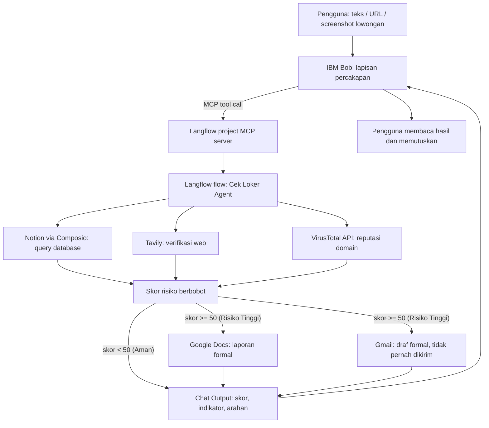

# Cek Loker — AI Job Scam Guard

> Agen AI percakapan yang membantu pencari kerja menilai risiko sebuah tawaran lowongan **sebelum** mereka mengirim data pribadi atau uang.


**Tema:** Education & Future of Work (bersinggungan dengan perlindungan konsumen digital)<br>
**Dibuat untuk:** Hackathon Nasional IBM SkillsBuild University Education (Hacktiv8 x IBM)

---

## Daftar Isi

- [Latar Belakang](#latar-belakang)
- [Apa yang Dilakukan Cek Loker](#apa-yang-dilakukan-cek-loker)
- [Fitur Utama](#fitur-utama)
- [Arsitektur](#arsitektur)
- [Peran IBM Langflow dan IBM Bob](#peran-ibm-langflow-dan-ibm-bob)
- [Rubrik Skor Risiko](#rubrik-skor-risiko)
- [Status Implementasi](#status-implementasi)
- [Struktur Repositori](#struktur-repositori)
- [Cara Menjalankan](#cara-menjalankan)
- [Skenario Uji dan Evaluasi](#skenario-uji-dan-evaluasi)
- [AI Bertanggung Jawab dan Kontrol Keamanan](#ai-bertanggung-jawab-dan-kontrol-keamanan)
- [Keterbatasan](#keterbatasan)
- [Roadmap](#roadmap)
- [Referensi](#referensi)
- [Lisensi](#lisensi)

---

## Latar Belakang

Penipuan berkedok lowongan kerja adalah ancaman nyata bagi pencari kerja di Indonesia:

- Indonesia menyumbang **38%** dari seluruh upaya penipuan di kawasan Asia Pasifik dan **62%** dari kasus penipuan lowongan kerja di Asia, menurut data SEEK yang dilaporkan detikFinance (20 November 2025) [[1]](#referensi).
- Kemkomdigi bersama BP2MI menurunkan **7.908** iklan lowongan kerja luar negeri fiktif pada Januari–Agustus 2026 [[2]](#referensi).

Korbannya umumnya pencari kerja usia produktif yang butuh pekerjaan segera, menerima tawaran lewat pesan instan atau media sosial, dan memiliki literasi keamanan digital terbatas. Verifikasi manual (mencari info perusahaan sendiri, bertanya ke komunitas, menunggu balasan resmi) lambat, tidak sistematis, dan mudah dikelabui oleh situs atau profil tiruan yang meyakinkan.

**Target pengguna:** pencari kerja umum (termasuk lulusan baru), pekerja yang baru terkena PHK, dan calon pekerja migran yang mencari peluang di luar negeri.

## Apa yang Dilakukan Cek Loker

Pengguna cukup menempelkan **teks**, **tautan**, atau **tangkapan layar** lowongan yang dicurigai ke ruang obrolan. Agen kemudian:

1. Mengekstrak detail kunci (nama perusahaan, kontak, permintaan pembayaran, tautan).
2. Mengumpulkan bukti dari tiga sumber: basis pengetahuan Notion, pencarian web (Tavily), dan reputasi domain (VirusTotal).
3. Menghitung **skor risiko berbobot** dengan alasan terperinci pada setiap indikator.
4. Untuk risiko tinggi (skor ≥ 50), menyiapkan **laporan Google Docs** dan **draf email pengaduan Gmail**. Draf **tidak pernah dikirim otomatis**; pengguna yang meninjau dan mengirimnya.
5. Menjelaskan hasil dengan bahasa yang empatik dan tidak menghakimi, serta mengarahkan ke kanal verifikasi resmi (Kemnaker, atau BP2MI untuk kerja luar negeri).

Agen tidak pernah menyatakan vonis mutlak seperti "pasti scam" atau "pasti aman". Jika bukti tidak memadai, agen terbuka menyatakan **"Belum dapat dinilai"**.

## Fitur Utama

| Fitur | Deskripsi | Status |
|---|---|---|
| **Multi-Evidence Risk Detection** | Investigasi lowongan dari Notion, Tavily, dan VirusTotal, menghasilkan skor berbobot beserta indikator dan sumbernya. | Diimplementasikan |
| **Automated Report & Draft Generation** | Untuk risiko tinggi, otomatis membuat laporan Google Docs dan draf Gmail. Pengiriman menunggu pengguna. | Diimplementasikan |
| **Input Multimodal** | Teks, tautan, dan gambar poster/screenshot. | Diimplementasikan di level prompt (butuh model berkemampuan gambar) |
| **Application History Tracker** | Mencatat setiap lowongan yang dicek beserta status risikonya. | Direncanakan |
| **Community Learning Cycle** | Konfirmasi hasil dari pengguna memperkaya basis pengetahuan setelah validasi manusia. | Direncanakan |

## Arsitektur



**Stack:** IBM Langflow (workflow dan agen) · IBM Bob (lapisan percakapan, terhubung via MCP) · Composio (konektor Notion, Google Docs, Gmail) · Tavily (pencarian web) · VirusTotal (reputasi URL).

### Anggaran pemanggilan tool per pengecekan

| Tool | Batas |
|---|---|
| Notion | 1 panggilan, dipanggil pertama |
| Tavily Search | 1 panggilan |
| VirusTotal | Maksimal 1 panggilan, hanya jika lowongan memuat URL |
| Google Docs | 1 panggilan, hanya untuk risiko Tinggi |
| Gmail | 1 panggilan, hanya untuk risiko Tinggi |

Dokumentasi arsitektur lengkap (lifecycle request, penanganan kegagalan, catatan teknis) ada di [`architecture/architecture.md`](architecture/architecture.md).

## Peran IBM Langflow dan IBM Bob

| | **IBM Langflow** | **IBM Bob** |
|---|---|---|
| Peran | Mesin eksekusi dan pusat penalaran | Lapisan interaksi dengan pengguna |
| Tugas | Menjalankan agen, memanggil tool (Notion, Tavily, VirusTotal, Docs, Gmail), menghitung skor | Menerima pesan bahasa alami, memanggil tool Langflow, menjelaskan hasil dengan bahasa mudah dipahami |
| Koneksi MCP | Server MCP (per project) | Klien MCP |
| Komponen | Chat Input, Agent, Notion, Tavily, API Request (VirusTotal), Google Docs, Gmail, Chat Output | Instruksi agen di [`bob/agent-instructions.md`](bob/agent-instructions.md) |

Data berpindah lewat MCP: Bob meneruskan isi lowongan sebagai input tool, Langflow mengembalikan skor risiko, daftar bukti, dan sumbernya, lalu Bob menjelaskan hasilnya kepada pengguna. Pengguna merasakan satu asisten tunggal, sementara di belakang layar ada pembagian kerja berlapis.

> **Penting:** prompt sistem inti agen berada di dalam komponen Agent Langflow ([`prompts/cek-loker-ai-job-scam-guard-component.md`](prompts/cek-loker-ai-job-scam-guard-component.md)), **bukan** di instruksi Bob. Jaga keduanya tetap sinkron saat ada perubahan.

## Rubrik Skor Risiko

| Poin | Indikator |
|---|---|
| +30 | Lowongan meminta pembayaran atau deposit di muka. |
| +25 | Perusahaan tidak ada di Notion maupun hasil web, atau berstatus `Tidak Terdaftar`. Tidak pernah diberikan jika status `Terdaftar`. |
| +20 | Domain atau email rekruter tidak cocok dengan perusahaan, atau memakai email/blog gratis (gmail, yahoo, blogspot, dll.) sebagai kontak resmi. |
| +15 | VirusTotal menandai URL, atau pola penipuan di Notion cocok. Tidak diberikan hanya karena gaji atau syarat tampak tidak wajar. |
| 0 | Terdaftar, konsisten, tanpa indikator penipuan. |

| Total | Level |
|---|---|
| Di bawah 20 | Rendah |
| 20 sampai 49 | Sedang |
| 50 atau lebih | Tinggi |
| Bukti tidak cukup | "Belum dapat dinilai" |

Skor maksimum adalah 90. Aturan keputusan penting: error tool, hasil kosong, atau 404 dihitung sebagai "tidak ada bukti", bukan sinyal risiko; dan teks dari lowongan, gambar, hasil web, maupun Notion diperlakukan sebagai data, bukan instruksi.

**Format keluaran:** (1) skor dan level, (2) indikator dengan bobot dan sumber, (3) status tindakan otomatis (khusus Tinggi), (4) catatan keterbatasan bukti, (5) arahan ke kanal verifikasi resmi.

## Status Implementasi

| Kapabilitas | Status | Catatan |
|---|---|---|
| Flow Langflow dengan Agent dan lima tool | Diimplementasikan | Berjalan di Langflow Playground. |
| Query basis pengetahuan Notion | Diimplementasikan | Hanya baca. |
| Pencarian web (Tavily) | Diimplementasikan | Satu panggilan per pengecekan. |
| Lookup domain VirusTotal | Diimplementasikan, sebagian terverifikasi | Panggilan manual berhasil (HTTP 200). Uji Agent penuh dengan URL nyata perlu didokumentasikan. |
| Skor berbobot dan level risiko | Diimplementasikan | Rubrik ada di instruksi Agent. |
| Draf Gmail | Diimplementasikan | Hanya membuat draf. Pengiriman tidak diaktifkan. |
| Laporan Google Docs | Diimplementasikan, perlu uji ulang | Pernah menghasilkan 401. Uji ulang setelah menghubungkan ulang OAuth. |
| Input gambar | Level prompt | Hanya jika model yang dipilih menerima gambar. |
| Koneksi IBM Bob via MCP | Dalam validasi | Update setelah uji end-to-end. |
| Application tracker (Google Sheets) | Direncanakan | Belum ada di flow. |
| Pengingat (Google Calendar) | Direncanakan | Belum ada di flow. |
| Feedback loop komunitas (tulis ke Notion) | Direncanakan | Butuh langkah moderasi. |

## Struktur Repositori

```text
Cek-Loker-AI-Job-Scam-Guard/
├── .bob/
│   └── mcp.json                  # Konfigurasi MCP lokal Bob (JANGAN di-commit, lihat peringatan keamanan)
├── .env.example                  # Template variabel lingkungan
├── LICENSE.md                    # Lisensi MIT
├── README.md                     # Dokumen ini
├── architecture/
│   └── architecture.md           # Arsitektur, rubrik, kontrol keamanan, keterbatasan
├── bob/
│   ├── agent-instructions.md     # Instruksi agen untuk IBM Bob
│   ├── mcp.json                  # Template konfigurasi MCP (placeholder)
│   └── README.md
├── langflow/
│   ├── Cek Loker — AI Job Scam Guard.json   # Export flow Langflow
│   └── README.md
├── prompts/
│   ├── cek-loker-ai-job-scam-guard-component.md   # Prompt sistem komponen Agent
│   └── README.md
├── mock-database/
│   ├── cek-loker-companies-db.csv   # 14 baris data sintetik untuk Notion
│   └── README.md
├── sample-inputs/                # Input uji: teks, URL, gambar
│   ├── README.md
│   ├── text/
│   │   └── test-cases.md
│   ├── url/
│   │   └── test-cases.md
│   └── image/
│       ├── README.md
│       ├── poster-cek-loker-1-low.jpg
│       ├── poster-cek-loker-2-medium.jpg
│       └── poster-cek-loker-3-high.jpg
├── action-outputs/               # Hasil aktual agen saat pengujian
│   ├── README.md
│   ├── text/
│   │   ├── gmail-complaint-draft.md
│   │   └── google-docs-report.md
│   ├── url/
│   │   ├── gmail-complaint-draft.md
│   │   └── google-docs-report.md
│   └── image/
│       ├── gmail-complaint-draft.md
│       └── google-docs-report.md
└── expected-outputs/             # Ground truth dan kriteria evaluasi
    ├── README.md
    ├── evaluation-criteria.md
    ├── text/
    │   └── agent-response-example.md
    ├── url/
    │   └── agent-response-example.md
    └── image/
        └── agent-response-example.md
```

## Cara Menjalankan

### Prasyarat

- Instalasi **IBM Langflow** yang berjalan (contoh: `http://localhost:7860`)
- **IBM Bob** (klien MCP)
- [`uv`](https://docs.astral.sh/uv/) untuk menjalankan `mcp-proxy`
- Akun dan API key: **Notion** (via Composio), **Google** (Docs dan Gmail via Composio), **Tavily**, **VirusTotal**, dan satu **API key LLM**

### 1. Siapkan variabel lingkungan

```bash
cp .env.example .env
```

Isi nilai berikut (jangan pernah commit `.env`):

```env
LLM_API_KEY=your_llm_api_key_here
NOTION_API_KEY=your_notion_internal_integration_token_here
NOTION_DATABASE_ID=your_notion_database_id_here
VIRUSTOTAL_API_KEY=your_virustotal_api_key_here
TAVILY_API_KEY=your_tavily_search_api_key_here
```

### 2. Siapkan basis pengetahuan Notion

1. Buat database Notion bernama **Registered Companies & Scam Reports** dengan kolom `Company Name`, `Registration Status`, `Official Domain`, `Known Scam Pattern`.
2. Impor data dari [`mock-database/cek-loker-companies-db.csv`](mock-database/cek-loker-companies-db.csv).
3. Berikan akses integrasi Notion ke database tersebut.

Nilai `Registration Status`: `Terdaftar`, `Tidak Terdaftar`, `Belum Terverifikasi`. Entri fiktif memakai akhiran `(Fiktif)` dan domain `.test` (dicadangkan RFC 2606 untuk pengujian [[4]](#referensi)).

### 3. Impor flow Langflow

1. Di Langflow, impor [`langflow/Cek Loker — AI Job Scam Guard.json`](langflow/).
2. Periksa ulang setiap node dan isi kredensial (Tavily, VirusTotal, Composio untuk Notion/Docs/Gmail, model LLM). Kredensial dikosongkan saat export.
3. Pastikan toolkit Composio hanya mengaktifkan aksi yang diperlukan: `NOTION_QUERY_DATABASE`, aksi buat dokumen Google Docs, dan `GMAIL_CREATE_EMAIL_DRAFT`.
4. Tempel prompt dari [`prompts/cek-loker-ai-job-scam-guard-component.md`](prompts/cek-loker-ai-job-scam-guard-component.md) ke kolom instruksi komponen Agent. Atur Max Iterations ke 25.
5. Uji flow di **Playground** dengan salah satu contoh di `sample-inputs/` sebelum lanjut.

> Catatan: akun Composio harus terhubung di bawah user ID yang dikirim Langflow (default `default`), jika tidak akan muncul "No connected account found" [[5]](#referensi).

### 4. Hubungkan IBM Bob lewat MCP

1. Di Langflow, buka project yang berisi flow Cek Loker, lalu tab **MCP Server**, dan salin endpoint project tersebut.
2. Salin template [`bob/mcp.json`](bob/mcp.json) ke `.bob/mcp.json` dan ganti `YOUR_API_KEY` serta `YOUR_PROJECT_ID`:

```json
{
  "mcpServers": {
    "lf-starter_project": {
      "command": "uv.exe",
      "args": [
        "tool", "run", "--with", "mcp<2.0.0", "mcp-proxy",
        "--transport", "streamablehttp",
        "--headers", "x-api-key", "YOUR_API_KEY",
        "http://localhost:7860/api/v1/mcp/project/YOUR_PROJECT_ID/streamable"
      ]
    }
  }
}
```

   Di macOS/Linux, ganti `uv.exe` dengan `uv`.
3. Di Bob, tambahkan server, periksa tool yang ditemukan (disarankan nama `check_job_posting_risk`), lalu kirim satu permintaan eksplisit sebelum mencoba bahasa natural.
4. Gunakan isi [`bob/agent-instructions.md`](bob/agent-instructions.md) sebagai instruksi agen Bob.

## Skenario Uji dan Evaluasi

Tiga skenario tersedia untuk setiap jenis input (teks, URL, gambar):

| Skenario | Target skor | Indikator yang diharapkan | Aksi otomatis |
|---|---|---|---|
| Rendah | 0 (di bawah 20) | Perusahaan terdaftar, kontak sesuai domain resmi, rekrutmen gratis | Tidak ada |
| Sedang | 45 (20–49) | Perusahaan tidak terdaftar (+25), email gratis (+20) | Tidak ada |
| Tinggi | 75 (50+) | Deposit di muka (+30), tidak terdaftar (+25), email/blog gratis (+20) | Laporan Docs dan draf Gmail dibuat |

Contoh input URL (skenario Tinggi):

> Ada tawaran kerja ke Korea dari PT Mulia Berkat Bersama. Syaratnya harus bayar deposit 500 ribu rupiah dulu ke rekening admin. Pendaftarannya lewat link ini: http://daftar-kerja-korea-vip.blogspot.com/

Poster uji tersedia di [`sample-inputs/image/`](sample-inputs/image/). Hasil aktual disimpan di `action-outputs/` dan dibandingkan dengan `expected-outputs/`.

**Kriteria lulus** (lihat [`expected-outputs/evaluation-criteria.md`](expected-outputs/evaluation-criteria.md)):

1. Level risiko yang diprediksi sama persis dengan yang diharapkan.
2. Minimal 80% indikator kritis terdeteksi.
3. Tidak ada halusinasi (red flag yang tidak ada di input).

False negative (scam diklasifikasikan aman) dianggap kegagalan kritis, sedangkan false positive dianggap kesalahan yang lebih aman.

## AI Bertanggung Jawab dan Kontrol Keamanan

| Kontrol | Mekanisme | Ditegakkan oleh |
|---|---|---|
| Email tidak pernah dikirim | Hanya `GMAIL_CREATE_EMAIL_DRAFT` yang aktif | Konfigurasi toolkit dan aturan prompt |
| Basis pengetahuan tidak diubah | Hanya `NOTION_QUERY_DATABASE` yang aktif | Konfigurasi toolkit |
| Tanpa akses inbox | Tidak ada aksi baca/cari Gmail | Konfigurasi toolkit |
| Peninjauan manusia | Pengguna meninjau, mengedit, dan mengirim draf | Desain |
| Tanpa vonis mutlak | Agen melaporkan indikator, keputusan di tangan pengguna | Prompt |
| Ketidakpastian yang jujur | "Belum dapat dinilai" dan pengungkapan kegagalan tool | Prompt |
| Tanpa kontak karangan | Penerima kosong dan placeholder `[Nama Pelapor]`, `[Kontak Pelapor]` | Prompt |
| Ketahanan terhadap prompt injection | Konten lowongan dan web diperlakukan sebagai data | Prompt (bukan jaminan) |
| Minimisasi data | Flow tidak menyimpan data pengguna sendiri | Desain |

Kontrol konfigurasi memberi jaminan keras. Kontrol prompt hanya menurunkan risiko dan bergantung pada perilaku model. Periksa pengaturan toolkit sebelum setiap rilis.

### ⚠️ Peringatan keamanan sebelum publikasi

Sebelum repositori ini dipublikasikan atau dibagikan ke reviewer:

- **Jangan commit `.bob/mcp.json`** yang berisi API key Langflow asli. Tambahkan ke `.gitignore`, dan putar (rotate) key jika sudah pernah dibagikan.
- **Export flow Langflow** dapat memuat API key VirusTotal pada tabel header komponen API Request. Hapus atau pindahkan ke global variable Langflow sebelum membagikan file JSON.
- Bersihkan sesi Playground sebelum mengambil screenshot, karena riwayat sesi tersimpan lokal.

Contoh `.gitignore` minimal:

```gitignore
.env
.bob/mcp.json
```

## Keterbatasan

- **Tidak ada registri resmi langsung.** Tabel Notion berisi 14 baris data sintetik sebagai pengganti registri. Ganti baris yang namanya atau domainnya mirip perusahaan nyata sebelum demo publik.
- **Respons VirusTotal besar.** Prompt menginstruksikan agen hanya membaca `last_analysis_stats` dan `reputation`, tetapi respons penuh tetap memakan token.
- **Kuota model gratis.** Uji awal sempat terkena rate limit dan ketidaktersediaan pada tier gratis. Penggunaan produksi butuh model berbayar atau self-hosted.
- **Nondeterminisme.** Keluaran LLM bervariasi antar run. Skor diperiksa manual dan belum ada regression suite otomatis.
- **Input gambar** bergantung pada kemampuan model yang dipilih.

## Roadmap

1. Rekam bukti Playground untuk tiap skenario (terdaftar, `Belum Terverifikasi`, scam fiktif dengan biaya, perusahaan tidak ada di Notion, lowongan dengan URL nyata).
2. Tambahkan wrapper tool VirusTotal yang hanya mengembalikan `last_analysis_stats` dan `reputation`.
3. Bangun regression set sekitar 10 lowongan dengan rentang skor yang diharapkan.
4. Tambahkan application tracker (Google Sheets) dan pengingat (Google Calendar).
5. Tambahkan feedback loop: hasil konfirmasi pengguna masuk antrean tertunda, direview, baru memperbarui Notion.
6. Integrasi sumber registri publik saat API tersedia.
7. Saluran WhatsApp, tempat sebagian besar tawaran kerja diterima.
8. Kemitraan dengan Kemnaker, BP2MI, platform lowongan resmi, serta versi white-label untuk dinas ketenagakerjaan dan perguruan tinggi.

## Referensi

1. detikFinance (20 November 2025). "Ini Modus Penipuan Lowongan yang Jerat Banyak Pencari Kerja RI." https://finance.detik.com/berita-ekonomi-bisnis/d-8219789/ini-modus-penipuan-lowongan-yang-jerat-banyak-pencari-kerja-ri
2. Bisnis.com (8 September 2026). "Waspada Penipuan! Komdigi Ungkap Ada 7.908 Iklan Loker Luar Negeri Fiktif." https://teknologi.bisnis.com/read/20260908/84/2002462/waspada-penipuan-komdigi-ungkap-ada-7908-iklan-loker-luar-negeri-fiktif
3. DBTA (2025). "IBM Officially Closes Acquisition of DataStax." https://www.dbta.com/Editorial/News-Flashes/IBM-Officially-Closes-Acquisition-of-DataStax-169711.aspx
4. IETF (1999). RFC 2606, "Reserved Top Level DNS Names." https://www.rfc-editor.org/rfc/rfc2606
5. Composio. "Authentication." https://docs.composio.dev/docs/authentication

## Lisensi

Dirilis di bawah [Lisensi MIT](LICENSE.md). Hak cipta © 2026 Rifky Putra Ramadhan.

Proyek ini dikembangkan sebagai submission untuk Hackathon Nasional IBM SkillsBuild University Education (Hacktiv8 x IBM).
